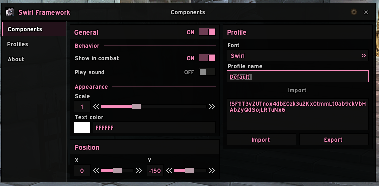
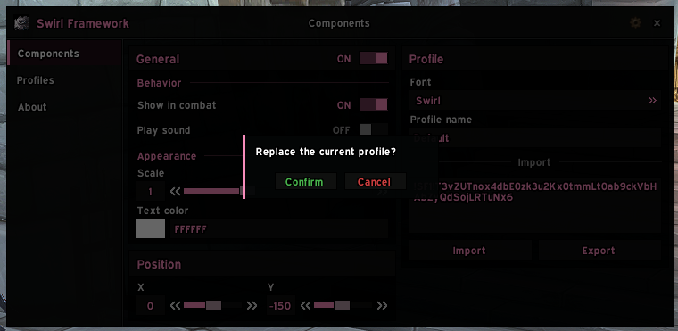
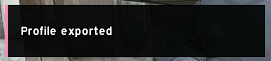
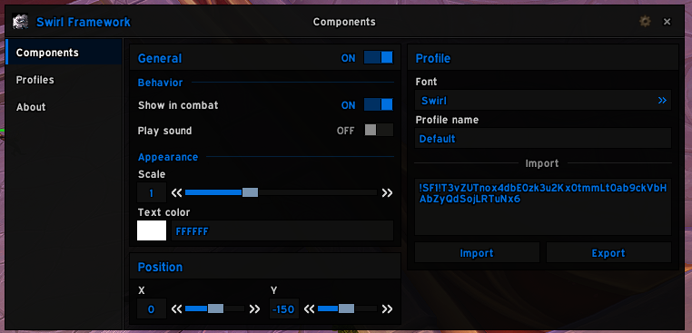
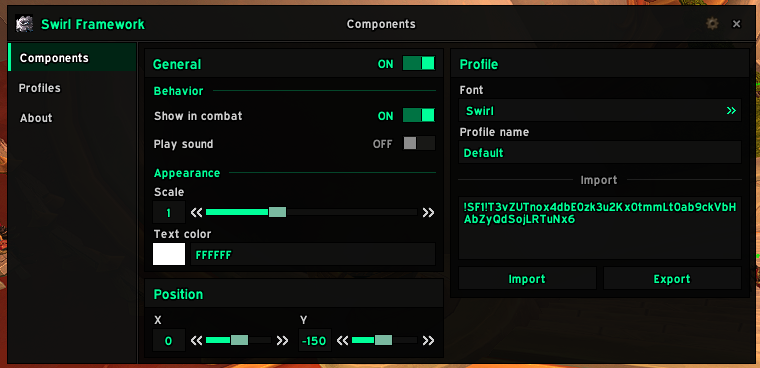
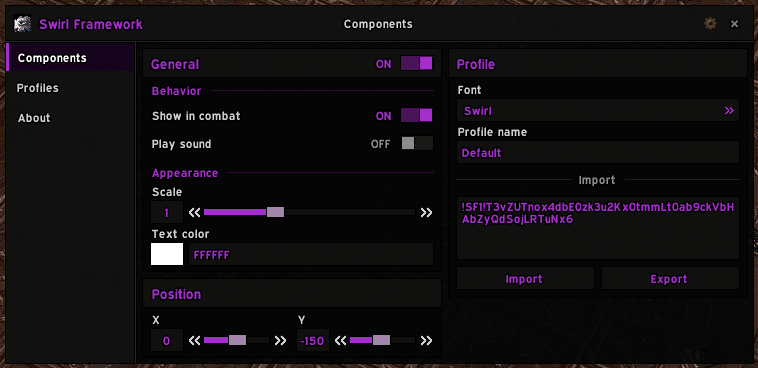
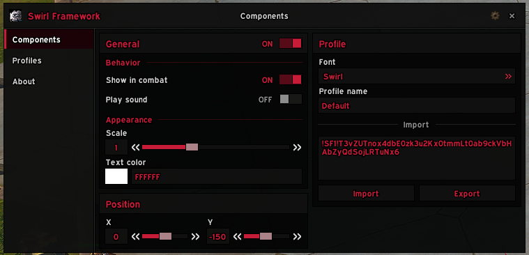

# Swirl Framework
UI component library for World of Warcraft addons: windows, tabs and controls with a shared theme, embedded into each addon that uses it.



## What's in it
- **Window:** a movable window with a header, icon, title, page title, close button and an optional settings gear. It can size itself to its content.
- **Layout:** vertical tabs, cards with titles and dividers, and a scrollbar that attaches to any scroll frame.
- **Controls:** buttons, icon buttons, toggles, sliders, dropdowns, text boxes, color pickers and an x/y position control.
- **Notifications:** toasts, and confirm dialogs that can dim and attach to a window.

 

## Usage
The framework isn't installed as its own addon. Each addon carries its own copy in a `UI` folder.

Add it as a submodule for development:

```sh
git submodule add https://github.com/lolswirl/swirl-framework UI
```

Add it as an external in `.pkgmeta` so the packager copies it into releases:

```yaml
externals:
    UI:
        url: https://github.com/lolswirl/swirl-framework
        branch: main
```

Load it in your `.toc` before your own files:

```
UI/SwirlFramework.xml

Core.lua
```

Then set it up with your addon's namespace:

```lua
local addonName, SF = ...
local C = SF.Components
local T = SF.Theme

SF.Setup(addonName)
SF.InitTheme()

local frame = CreateFrame("Frame", nil, UIParent, "BackdropTemplate")
C.SetBackdrop(frame, T.bg.dark, T.border.color)
```

Every file uses `local _, SF = ...`, so the framework lives in your addon's private namespace instead of a global. Two addons on different versions of it can't conflict.

## Theme
Colors, fonts, padding and sizes all come from one theme table in `Theme.lua`. Components read from it instead of hard-coding values, so a change there applies everywhere.

`SF.InitTheme()` sets the accent color to the player's class color, plus a dimmed and a faded version of it. Skip it and set `T.accent`, `T.accentDim` and `T.accentFade` yourself for a fixed brand color.

 
 

## Used by
- [Instance Loadouts](https://github.com/Bisse123/InstanceLoadouts)
- [SwirlUI Core](https://github.com/swirladdons/swirluicore)
- [Dump Truck](https://github.com/swirladdons/dumptruck)
- [Brain Freeze](https://github.com/swirladdons/brainfreeze)

## License
MIT
